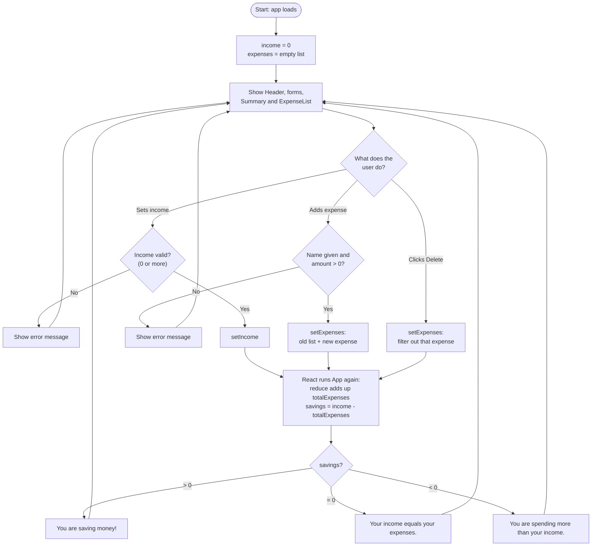

# Budget Tracker: Learning Guide

Contents

1. Pseudocode
2. Flowchart
3. How HTML, CSS, JavaScript and React are used
4. Key programming concepts
5. Human vs AI solution comparison
6. Student reflection questions

---

## 1. Pseudocode

```
START App

  DEFINE categories = [Food, Transport, Education, Entertainment, Other]

  CREATE state income = 0
  CREATE state expenses = empty list

  FUNCTION addExpense(newExpense)
      expenses = old expenses + newExpense
  END FUNCTION

  FUNCTION deleteExpense(id)
      expenses = all expenses whose id is NOT the given id
  END FUNCTION

  totalExpenses = add up the amount of every expense
  savings       = income - totalExpenses

  SHOW Header
  SHOW IncomeForm
  SHOW ExpenseForm
  SHOW Summary
  SHOW ExpenseList
END App


IncomeForm
  CREATE state incomeText, error
  WHEN the form is submitted
      IF incomeText is empty OR less than 0
          error = "Enter an income of 0 or more."
      ELSE
          tell App to set the income
          clear the input and the error
      END IF


ExpenseForm
  CREATE state name, amount, category, error
  WHEN the form is submitted
      IF name is empty OR amount is empty OR amount <= 0
          error = "Enter a name and an amount greater than 0."
      ELSE
          build an expense {id, name, amount, category}
          tell App to add it
          reset the form
      END IF


ExpenseList
  IF there are no expenses
      SHOW "No expenses yet"
  ELSE
      FOR EACH expense
          SHOW name, amount, category and a Delete button
          WHEN Delete is clicked, tell App to delete this expense's id
      END FOR
  END IF


Summary
  SHOW income, totalExpenses, savings
  IF savings > 0       SHOW "You are saving money!"
  ELSE IF savings = 0  SHOW "Your income equals your expenses."
  ELSE                 SHOW "You are spending more than your income."
  SHOW CategorySummary


CategorySummary
  FOR EACH category
      get the expenses in that category
      add up their amounts
      work out its percentage of total spending
      SHOW the name, total and a bar
  END FOR
```

---

## 2. Flowchart



---

## 3. How HTML, CSS, JavaScript and React are used

| Technology | Job in this project | Where to look |
|---|---|---|
| **HTML** | The structure of the page: headings, forms, inputs, a table, buttons. `index.html` holds one empty `<div id="root">`. All other HTML is written inside the React components as JSX. | `index.html`, the `return (...)` in each component |
| **CSS** | The look of the page: colors, spacing, fonts, the card layout, the two-column layout on large screens, and the colored savings message. No Bootstrap or Tailwind is used. | `src/index.css`, `src/App.css` |
| **JavaScript** | The logic: checking input, adding up totals, filtering lists, choosing which message to show. | The functions and calculations inside each component |
| **React** | A JavaScript library that builds the page from small reusable pieces (components). When state changes, React redraws only what needs to change, so we never edit the page by hand. | `useState`, props, `map()` in JSX |

How they fit together:

1. The browser loads `index.html` (HTML).
2. `index.html` loads `main.jsx` (JavaScript), which asks React to draw `<App />` inside `#root`.
3. `App` and its child components return JSX, which looks like HTML but lives inside JavaScript.
4. CSS classes such as `className="card"` connect the JSX to the rules in the `.css` files.
5. When the user clicks or types, an event handler changes state, React runs the components again, and the screen updates.

**Vite** is the tool that runs a local development server and turns JSX into code the browser understands.

---

## 4. Key programming concepts

All examples are taken from this project.

### Variables

A variable stores a value with a name.

```jsx
const totalExpenses = expenses.reduce((total, expense) => total + expense.amount, 0);
const savings = Math.round((income - totalExpenses) * 100) / 100;
```

`const` means the name cannot be reassigned. `let` (used for `statusClass` in `Summary.jsx`) can be reassigned.

### Arrays

An array is an ordered list of items.

```jsx
const CATEGORIES = ["Food", "Transport", "Education", "Entertainment", "Other"];
const [expenses, setExpenses] = useState([]);   // starts as an empty array
```

Each expense is an **object**, a bundle of named values:

```jsx
{ id: 1712345678, name: "Lunch", amount: 8.5, category: "Food" }
```

### Loops

A loop repeats work for each item. In React we usually use array methods instead of `for` loops: `map()`, `filter()` and `reduce()` (see below). Each one loops over the array for you.

The same total written with a classic loop:

```jsx
let total = 0;
for (let i = 0; i < expenses.length; i++) {
  total = total + expenses[i].amount;
}
```

`reduce()` does exactly this in one expression.

### Conditions

A condition chooses what happens.

```jsx
if (savings > 0) {
  statusClass = "positive";
} else if (savings < 0) {
  statusClass = "negative";
}
```

In JSX, **conditional rendering** shows or hides parts of the screen:

```jsx
{savings > 0 && <p>You are saving money!</p>}                 // && : show only if true
{expenses.length === 0 ? <p>No expenses yet.</p> : <table>…</table>}   // ? : either/or
```

### Functions

A function is a named block of code you can run many times.

```jsx
function deleteExpense(idToDelete) {
  setExpenses(expenses.filter((expense) => expense.id !== idToDelete));
}
```

Every React component is also a function that returns JSX: `function Header() { return (...); }`.

**Arrow functions** are a shorter way to write a function: `(expense) => expense.amount`.

### `useState`

`useState` gives a component memory. When the state changes, React redraws the component.

```jsx
const [income, setIncome] = useState(0);
//     ^value  ^function to change it   ^starting value
```

Never change state directly (`income = 500`). Always use the setter (`setIncome(500)`). For arrays, make a **new** array: `setExpenses([...expenses, newExpense])`.

### Props

Props pass data and functions from a parent component to a child, like function arguments.

```jsx
// Parent (App.jsx)
<ExpenseList expenses={expenses} onDeleteExpense={deleteExpense} />

// Child (ExpenseList.jsx)
function ExpenseList({ expenses, onDeleteExpense }) { … }
```

Data flows **down** through props. When a child needs to change something (such as deleting an expense), the parent passes it a function to call.

### Event handling

An event is something the user does. Handlers are functions attached to JSX:

```jsx
<input onChange={(event) => setName(event.target.value)} />
<form onSubmit={handleSubmit}>
<button onClick={() => onDeleteExpense(expense.id)}>Delete</button>
```

`event.preventDefault()` stops the browser from reloading the page when a form is submitted.

### `map()`

`map()` turns each item of an array into something new and returns a new array. In React it turns data into JSX.

```jsx
{expenses.map((expense) => (
  <tr key={expense.id}> … </tr>
))}
```

The `key` helps React tell the rows apart.

### `filter()`

`filter()` keeps only the items that pass a test and returns a new array.

```jsx
expenses.filter((expense) => expense.category === "Food")   // only food expenses
expenses.filter((expense) => expense.id !== idToDelete)     // everything except one
```

### `reduce()`

`reduce()` combines all items into a single value.

```jsx
expenses.reduce((total, expense) => total + expense.amount, 0)
//               ^running total  ^current item              ^start at 0
```

Trace it with amounts `[5, 10, 3]`: `0+5 → 5`, `5+10 → 15`, `15+3 → 18`.

### Putting them together (`CategorySummary.jsx`)

```jsx
const total = expenses
  .filter((expense) => expense.category === categoryName)   // 1. keep one category
  .reduce((sum, expense) => sum + expense.amount, 0);       // 2. add them up
```

and `categories.map(...)` repeats this for every category.

---

## 5. Human vs AI solution comparison

Use this section as a class activity. Students write their own solution first, then compare it with this one.

| Area | A typical student (human) solution | This AI-generated solution | Questions to discuss |
|---|---|---|---|
| **Planning** | Often starts coding straight away and adds features as ideas come. | Started from the full list of requirements, so the components and data flow were decided up front. | Which approach finds problems sooner? |
| **Structure** | Often one large `App.jsx` with all code inside. | Split into 7 small components, each with one job. | Is smaller always better? Where is the line? |
| **Edge cases** | Often handles only the "happy path". | Checks empty names, zero or negative amounts, and rounds savings to avoid `0.1 + 0.2` errors. | What other bad inputs could a user type? |
| **Naming and comments** | Short names like `x`, `e`, `list`. | Descriptive names (`totalExpenses`, `onDeleteExpense`) and beginner comments. | How does naming help the next reader? |
| **Creativity** | May add personal touches: a favourite color scheme, a joke, a feature the AI would not guess. | Follows the brief closely and adds only small extras (percent bars, error messages). | What would make this app yours? |
| **Understanding** | Learned by struggling with bugs, so the reasoning is deeply understood. | Produced quickly, but the author did not experience the debugging. | Why can you not skip understanding code you did not write? |
| **Testing** | Tests in the browser as they go. | The code has not been run through an automated test suite, so it still needs a human to try it. | How would you test this app? List 5 checks. |
| **Mistakes** | Mistakes are visible in the history of attempts. | May contain mistakes that look confident and tidy. | How do you check AI-written code? |

Key point for students: **AI output is a starting point to read, test and question, not an answer to trust.**

Activity:

1. Build your own version without looking at this one.
2. Compare the two. List three things the AI version does better and three things yours does better.
3. Find one thing in the AI code you do not understand. Explain it to a partner.
4. Change one feature (for example, add a new category) and predict which files need to change before you try.

---

## 6. Student reflection questions

**Understanding the code**

1. Which component holds the `expenses` state? Why is it kept there and not inside `ExpenseList`?
2. What happens on screen when you click Delete? Describe each step from the click to the updated list.
3. Why do we write `setExpenses([...expenses, newExpense])` and not `expenses.push(newExpense)`?
4. `totalExpenses` and `savings` are not stored in state. Why is that a good choice?
5. In `CategorySummary`, what is the output of `filter()` and what does `reduce()` do with it?

**Thinking about design**

6. Which props does `Summary` receive? Could you remove any? What would you lose?
7. Why does the app check input before adding an expense? Name two bad inputs it blocks.
8. What would you change to make the app work for a family with several people?

**Extending the project**

9. Add a new category called "Health". Which lines or files must change? (Hint: look for `CATEGORIES`, and the colors in the CSS.)
10. Add a "Total number of expenses" line to the summary. Which method would you use?
11. The data disappears when you refresh the page. How could you keep it? (Hint: research `localStorage` and `useEffect`.)

**Reflecting on learning**

12. Which concept was hardest: state, props, `map()`, `filter()` or `reduce()`? What helped you understand it?
13. Where do you think the AI-written code is stronger than yours, and where is it weaker?
14. If you used AI help on this project, what did you check before you trusted it?
